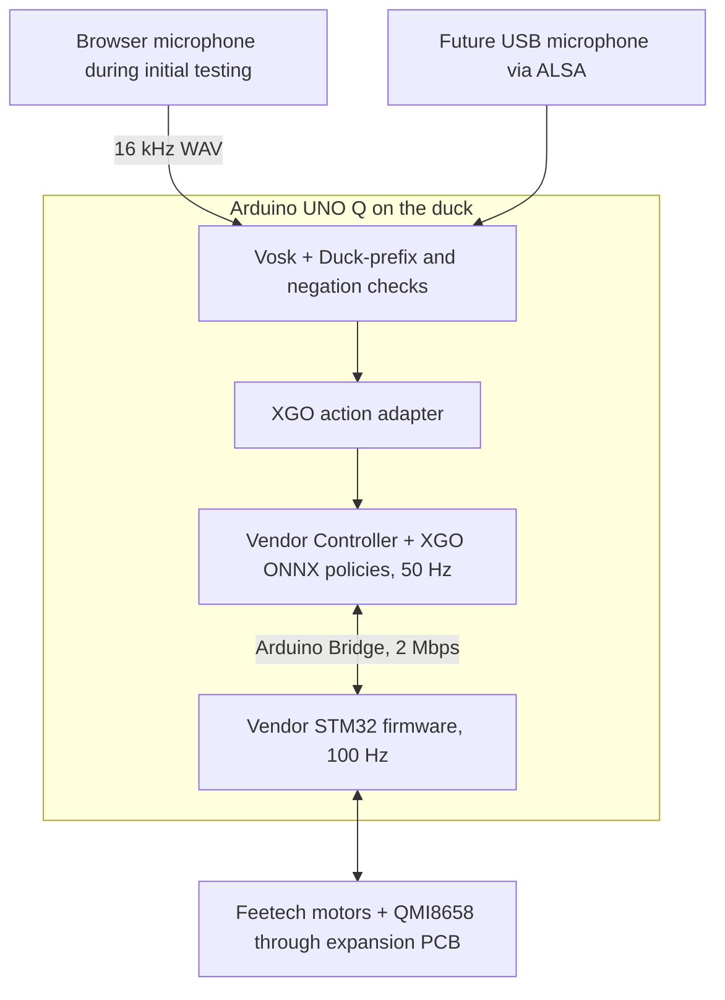
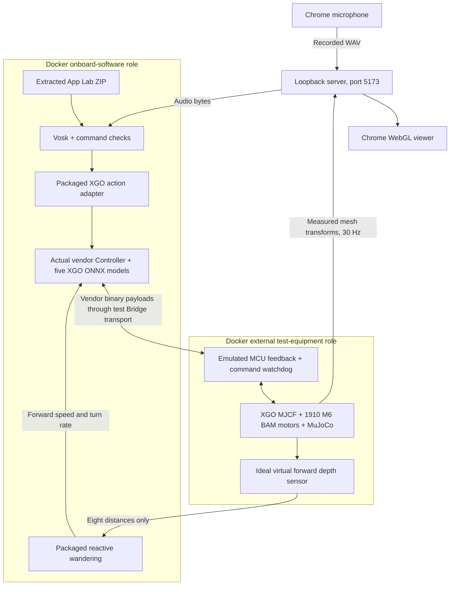

# Talking XGO Duck architecture

## Physical robot

The App Lab ZIP supplies Python/controller, XGO policies, firmware source and
control/voice pages. App Lab builds/flashes the sketch and runs Python on UNO Q
Linux. The browser microphone replaces future physical capture; recognition
and command interpretation stay onboard. The speaker/conversation loop is not
implemented. MuJoCo and test adapters are not part of the robot application.

## Desktop simulation

The onboard image contains no MuJoCo library or physics meshes. It extracts the
same deployment ZIP. A desktop entry harness substitutes Bridge transport and
the HTTP framework; policy/control and speech classes are the real app code.
The Arduino App Lab framework and STM32 sketch are not executed on this PC.

The external role runs no speech or policy inference. It selects XGO mass/contact
geometry and its 1910 M6 BAM fit, at 7.4V, firmware kp=5 and a representative
15ms command lag. It emits vendor 240-byte feedback and consumes 80-byte commands.
This is an MCU interface emulator, not an electrical/CPU/firmware simulation.
Serial timing, calibration writes, actual sensor faults and physical performance
remain hardware checks. Commissioning operations are not faked as successful.

Startup pauses physics at spawn until first ARM. Reset restarts the simulated
body/MCU sequence and clears motor time history; the controller detects that
sequence restart and resets its filters. Neither is a physical-robot teleport
command. Once armed, all displayed movement is measured MuJoCo physics.

The browser interpolates poses with an 80ms buffer, freezes stale telemetry and
reports FPS/renderer. It runs no physics, recognition or policy. The loopback
server transports WAV/telemetry and never interprets speech.

## Limits

Obstacle avoidance does not require another reinforcement-learning run. The
virtual depth sensor measures distances; the packaged reactive behaviour
chooses forward speed and yaw; the existing learned walking policy supplies
joint targets and balance. The sensor itself makes no movement decisions.

Room mapping is a separate SLAM/localisation project. It needs calibrated
depth, an estimate of robot motion (odometry), sensor pose and uncertainty.
An IMU alone is not a reliable source of long-term room position. Pollen has
demonstrated onboard mapping with a VL53L5CX and leg odometry, but that does
not establish an XGO port or guarantee that our ideal sensor test transfers:
https://pollen-robotics.com/microduck/blog/microduck-slam/ .
No occupancy map, remembered room or route planner is currently implemented.

- Voice requires a complete Duck-prefixed command; typed manual controls do not.
- Walk has a two-second expiry; stop cancels its refresher. MCU watchdog is separate.
- Wander continuously refreshes walking/turn commands until stopped. The packaged
  behaviour receives only eight left-to-right distances, never world coordinates
  or a room map. Missing/stale/invalid readings stop travel. Reset cancels the
  behaviour before disarming. The hardware default refuses wandering without a
  range adapter. Compose alone opts into the virtual sensor endpoint.
- The virtual body-mounted sensor is an ideal stabilised horizontal slice:
  45 degrees, eight rays, 1.2 m cap. It is not a full VL53L5CX model, camera,
  floor/cliff detector, or proof of physical obstacle avoidance. Static room
  boxes and walls participate in physics as well as the browser display.
- Sit is understood but unavailable until an XGO sit/stand policy is deployed.
- The mouth slot has virtual feedback only; the walking MJCF has 14 hinges.
- Tests are synthetic-audio desktop checks, not real microphone/hardware certification.
- No conversation, physical audio playback or paid AI is enabled.

The standalone Pollen runtime, simulator and packages are retired. Attribution
inside XGO's derived code remains intact; see THIRD-PARTY.md. Purchase and print
audit records are retained.
