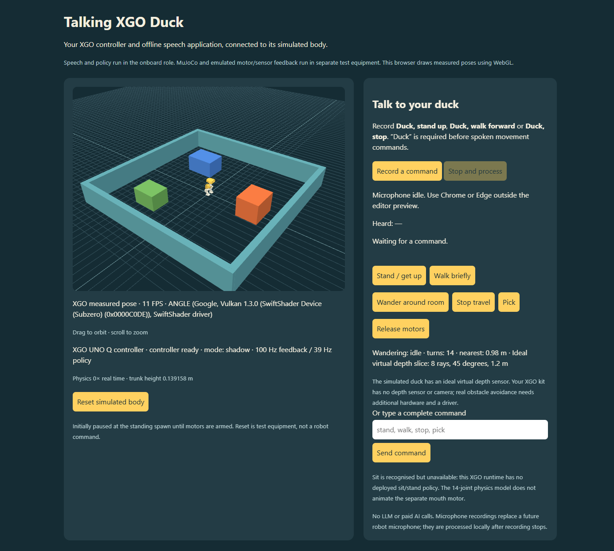

# Talking XGO Duck

Build, simulate and program XGO-Duck with Arduino UNO Q. This project now targets
XGO only. [Shopping list](research/procurement/order-list.md): kit/shipping paid
£306.46; full-size A1 selected. Procurement records are retained.

## Run

First setup requires **Git**, **Python 3.10+**, **Node.js 22+** and **Docker
Desktop with Linux containers** on Windows. GPU training is optional; it is
not needed to run the supplied policies or room avoidance.

```powershell
git clone --recurse-submodules https://github.com/ljmaslin/talkingRoboDuck.git
cd talkingRoboDuck
py -3 tools/bootstrap_project.py
```

Setup applies our runtime additions and downloads the 41 MB offline English
model from Vosk, checking its SHA-256 before extraction. It creates `.venv`.
Docker downloads the remaining simulation dependencies on first launch.
No API key or paid service is needed. Source-only setup is available with
`--skip-model`; an existing Vosk ZIP can be supplied with `--model-archive`.

On Linux, use `python3 tools/bootstrap_project.py`, then
`.venv/bin/python tools/build_xgo_app.py`,
`docker compose -f xgo-sim/compose.yaml up -d --build`, and
`node viewer/serve.mjs`. Only the Windows launcher/browser helper has been
exercised here; Docker physics itself runs on Linux.

Start Docker Desktop, run `Start-XgoDuck.cmd`, then open
**http://127.0.0.1:5173/** in Chrome or Edge outside the editor preview.
Stop the containers with `Stop-XgoDuck.cmd`. The launchers use a process-scoped
PowerShell execution option; they do not change the machine's script policy.

Record **Duck, stand up**, **Duck, walk forward**, or **Duck, stop**, then Stop
and process. Spoken movement requires Duck. Walking expires after two seconds;
Stop zeros travel while balance remains enabled. Release motors only while
supporting the robot. Reset simulated body is test equipment.

**Wander around room** (or **Duck, explore**) starts continuous reactive
walking and turning around three boxes inside a 2.4 m room. **Stop travel**
cancels it. There is no two-second limit in wandering mode; command and sensor
watchdogs remain enabled. This uses an explicitly simulated, ideal forward
depth sensor. The XGO kit has **no depth sensor or camera**. The portable
behaviour is packaged, but the physical sensor driver is not implemented.
[Sensor wiring, mounting and additional costs](research/procurement/xgo-sensing-upgrade.md).

The browser draws measured XGO MuJoCo geometry using WebGL. Physics, the 1910
motor model, ONNX control and recognition run in Docker. There is one robot,
no public visitors and no browser gait animation. `/native.html` redirects here.

## Layout

- `xgo-runtime/`: vendor UNO Q App Lab project, locally extended with our speech
  module and voice page, `/talk.html`. Includes XGO controller, policies, firmware.
- `xgo-rl/`: vendor training repository; desktop physics selects its XGO geometry
  and Feetech 1910 M6 BAM parameters.
- `xgo-sim/`: external body/MCU emulator and desktop Bridge transport adapter.
- `viewer/`: loopback browser display and microphone transport.
- `models/`: reusable offline speech model.
- `runtime-overlay/`: our tracked speech/wandering source plus an integration
  patch against the pinned upstream runtime. See [CONTRIBUTING.md](CONTRIBUTING.md).
- `artifacts/talking-xgo-0.2.0.zip`: importable Arduino App Lab application.

The onboard test container extracts **that same ZIP**, rather than using a
different simulation-only speech app. See [ARCHITECTURE.md](ARCHITECTURE.md)
and [DEPLOYMENT.md](DEPLOYMENT.md) for the boundary and installation.

## Capabilities and limits

Stand/get-up, brief walking, stop and pick are mapped to the real XGO controller.
Mouth targets use motor 34; the 14-joint walking MJCF has no mouth hinge, so that
movement is not physically simulated. Roller policy is packaged, but roller
geometry is not in the current desktop scene.

**Sit is recognised but refused:** the vendor runtime has no loaded sit/stand
policy. A training task alone is not a deployable model. No other robot's policy
is substituted. Negated, ambiguous and unprefixed speech cannot trigger movement.

The STM32 I/O interface is emulated, not its CPU or compiled sketch. Shipping
board drivers, physical calibration, acoustics and actual CPU/RAM performance
are not validated. The kit has no microphone/speaker. Real ALSA device access
requires hardware setup. Speech playback, conversation and person following are
not implemented. Paid API budget remains **£0**; no credentials are required.

## Verify / rebuild

```powershell
.\.venv\Scripts\python.exe -m unittest discover -s tests -v
.\.venv\Scripts\python.exe xgo-sim/test_integration.py
.\.venv\Scripts\python.exe tools/build_xgo_app.py
docker compose -f xgo-sim/compose.yaml up -d --build
```

Integration uses synthetic speech, the actual bundled Vosk model and XGO
controller. It checks rejection, unavailable sit, measured standing/travel,
expiry and stop. `artifacts/xgo-integration.json` is written only after success.
It is not a live-microphone or real-hardware benchmark. The package manifest
records upstream revisions and file hashes. See [THIRD-PARTY.md](THIRD-PARTY.md).
ARM64 checks cover manifest files, all five XGO models and six speech fixtures.
See `artifacts/xgo-arm64-check.json` and compare its package hash before relying
on it for a particular build. This checks
architecture compatibility, not the shipping App Lab image or board performance.
Curated reports from the working development build are in
[validation/](validation/README.md); downloaded models, built ZIPs, containers
and virtual environments are regenerated locally and excluded from Git.



## Reinforcement learning

Use the instructions in `xgo-rl/README.md`: Python 3.12, CUDA, `uv sync`, XGO
task registration and ONNX export. Training is separate from running supplied
policies. No training or paid compute run was launched; this PC's GPU training
compatibility remains unvalidated. Preserve joint order, home pose, observation
normalization and matching runtime/hardware revisions when deploying a model.
